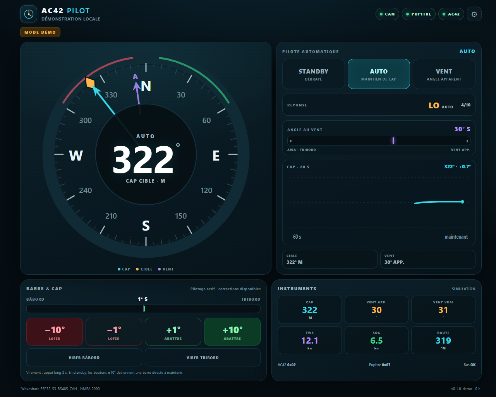
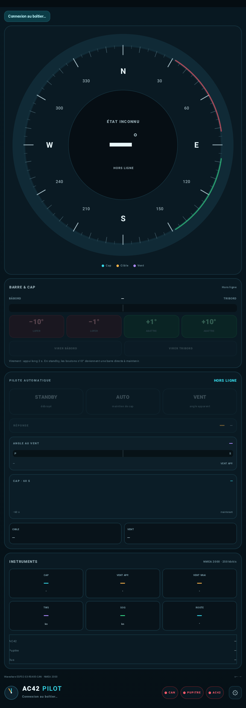

# AC42 Pilot — interfaz web para el piloto automático Simrad AC42

[English](README.md) · [Français](README.fr.md) · **Español**

Firmware para el módulo
[**Waveshare ESP32-S3-RS485-CAN**](https://www.waveshare.com/product/esp32-related/boards-kits/esp32-s3/esp32-s3-rs485-can.htm)
que expone una interfaz web móvil para controlar un piloto automático
**Simrad AC42** en un bus **NMEA 2000**.

El proyecto se inspira en el plugin de Signal K
[`signalk-ac42-autopilot`](https://github.com/CaptnOliv/signalk-ac42-autopilot)
tanto para la interfaz como para el protocolo Simnet, pero funciona de forma
autónoma: sin Signal K, sin servidor y sin ordenador de a bordo. La placa se
conecta directamente al bus NMEA 2000 y arranca como punto de acceso Wi-Fi. Se
puede configurar una red local (STA) desde la página de ajustes; si esa red deja
de ser accesible, el AP de respaldo se reactiva automáticamente.



Interfaz web de **escritorio** (1280 px). Interfaz móvil (390 px):
[docs/screenshot-mobile.png](docs/screenshot-mobile.png).

Página de ajustes de red: [docs/screenshot-settings.png](docs/screenshot-settings.png).

> Los documentos detallados de protocolo, cableado y API están actualmente en
> francés.

## Inspiración

El firmware, la interfaz web y la aplicación Android están **inspirados en el
plugin de SignalK [`signalk-ac42-autopilot`](https://github.com/CaptnOliv/signalk-ac42-autopilot)**,
que controla un AC42 desde Signal K. Este proyecto reutiliza:

- la presentación y la ergonomía de la interfaz web (compás, modos,
  correcciones, virada con pulsación larga, control directo del timón NFU,
  ajustes);
- las tramas Simnet PGN 130850 y 130845, los eventos de comando y las
  direcciones validadas en un AC42 real;
- la detección de la unidad de control B&G activa y el envío de comandos con su
  dirección de origen NMEA 2000.

La diferencia principal es la arquitectura: aquí todo está embarcado en la placa
ESP32-S3, sin Signal K, sin `canboat` y sin ordenador de a bordo. El plugin
`signalk-ac42-autopilot` sigue siendo la referencia del protocolo y la fuente de
inspiración de este proyecto. Este proyecto no está afiliado ni respaldado por
Signal K ni por el autor del plugin.

## Realización — vibe coding

Este proyecto se realizó mediante **«vibe coding»**: el firmware ESP32, la
interfaz web embebida, la aplicación Android, la documentación y las pruebas se
escribieron en diálogo con una IA, a partir de objetivos y comentarios humanos.

- **Herramienta**: [OpenCode](https://opencode.ai), agente de desarrollo en
  línea de comandos.
- **Modelo**: **DeepSeek** (DeepSeek V4.1 Flash).

El protocolo AC42/Simnet no se inventó: proviene del plugin
`signalk-ac42-autopilot` y de pruebas sobre el hardware. El vibe coding aceleró
la escritura del código, pero no sustituyó la verificación: la puesta en
servicio debe hacerse en el muelle, con las precauciones indicadas a
continuación.

## Advertencia — seguridad

**Este proyecto envía comandos reales a un piloto automático.** No está
certificado ni validado por Simrad/Navico. Un error de cableado, de protocolo o
de uso puede provocar un movimiento inesperado del timón.

- Pruebe primero **en el muelle**, con el timón despejado y alguien listo para
  pasar a standby.
- Mantenga siempre una vigilancia humana y un medio para detener el piloto.
- Nunca confíe en esta interfaz para la seguridad de la embarcación.
- Compruebe que la inyección de tramas en su bus NMEA 2000 está permitida y es
  adecuada para su instalación.

El AC42 solo acepta los comandos PGN 130850 si llevan **la dirección de origen
de una unidad de control B&G/Simrad activa** (puesto de mando, MFD, Triton…)
que emita su heartbeat PGN 65305. El firmware detecta esa unidad y envía los
comandos con su dirección de origen, exactamente igual que el plugin de Signal
K. Sin una unidad de control activa en el bus, el AC42 rechaza los comandos.

## Estado del proyecto

- Firmware compilado con PlatformIO 8.0.0 / Arduino ESP32 3.3.12.
- Pruebas de tramas NMEA 2000: 60 comprobaciones, todas superadas.
- Interfaz web probada en escritorio y móvil (390 px) con el servidor de
  demostración.
- Aplicación Android compilada (APK debug) y pruebas de análisis JSON: 3/3.
- **Aún no validado en un AC42 real con esta placa**: el protocolo procede del
  plugin `signalk-ac42-autopilot`, validado en un AC42, pero la puesta en
  servicio debe hacerse en el muelle.

## Funcionalidades

- Interfaz web embebida, responsive, en francés y sin dependencias externas.
- Modos **Standby**, **Auto** (mantenimiento de rumbo) y **Viento** (ángulo
  aparente).
- Correcciones de rumbo de **±1°** y **±10°**, con el sentido adaptado al modo.
- **Virada** a babor/estribor mediante pulsación larga de 2 s.
- **Control directo del timón NFU** en standby: pulsación mantenida, keepalive
  de 300 ms, parada automática por watchdog (retardo configurable, máximo 8 s).
- Perfil de respuesta del timón **LO / HI / AUTO** y nivel de respuesta 1–10
  leído del PGN 130845.
- Detección automática de la dirección de la unidad de control B&G y del AC42;
  las direcciones pueden forzarse desde la interfaz.
- Compás, rumbo objetivo, viento aparente/real, SOG, COG, timón y profundidad
  según los PGN disponibles en el bus.
- Diagnóstico: estado del CAN, direcciones N2K, contadores, registro y
  advertencias.
- Wi-Fi **AP por defecto**, red STA configurable desde la página de ajustes,
  **AP de respaldo automático**, mDNS `ac42-pilot.local`, ajustes persistentes
  en NVS.
- Servidor de demostración para PC para trabajar en la interfaz sin hardware.
- Pruebas de tramas NMEA 2000 ejecutables en PC.

## Hardware

El proyecto utiliza el módulo
[**Waveshare ESP32-S3-RS485-CAN**](https://www.waveshare.com/product/esp32-related/boards-kits/esp32-s3/esp32-s3-rs485-can.htm)
(SKU 32154, o 34781 para la versión con antena externa). Es el módulo al que
apuntan `platformio.ini` y el pinout siguiente.

- Alimentación de 7–36 V en la bornera, o USB-C de 5 V para desarrollo.
- Conexión CAN H / CAN L al backbone NMEA 2000.
- Terminación de 120 Ω en ambos extremos del backbone. El jumper de 120 Ω de la
  placa solo debe cerrarse si la placa está en un extremo del bus.
- Una unidad de control/puesto de mando B&G o Simrad activo en el mismo bus.

Pinout utilizado:

| Señal | GPIO |
|---|---|
| CAN TX | 15 |
| CAN RX | 16 |
| RS485 TX (no utilizado) | 17 |
| RS485 RX (no utilizado) | 18 |
| RS485 DIR (no utilizado) | 21 |
| RTC SDA/SCL (no utilizado) | 39 / 38 |

Consulte [docs/WIRING.md](docs/WIRING.md) (en francés) para el cableado y las
precauciones.

## Compilación y carga

Requisitos: [PlatformIO](https://platformio.org/) (VS Code o CLI).

```bash
pio run
pio run -t upload
pio device monitor
```

El proyecto utiliza:

- PlatformIO `espressif32@8.0.0`;
- framework Arduino ESP32 3.x;
- ArduinoJson 7;
- placa objetivo `esp32-s3-devkitc-1`, 16 MB de flash, partición de aplicación
  de 3 MB;
- USB CDC activado al arranque (`ARDUINO_USB_CDC_ON_BOOT=1`) para el monitor
  serie en el puerto USB-C.

Si la placa no se detecta, mantenga **BOOT**, pulse **RESET**, suelte **BOOT** y
reinicie la carga. El puerto serie funciona a 115200 baudios. Si la carga a
921600 baudios falla, reduzca `upload_speed` a `460800` en `platformio.ini`.

Tras la compilación, el uso de memoria es de aproximadamente **1,06 MB de
flash** y **58 KB de RAM** (sin las pilas Wi-Fi), lo que deja margen en la
partición de 3 MB.

## Wi-Fi

**No hay ninguna red local configurada de fábrica.** Al arrancar:

- si se ha guardado un SSID STA y es accesible, la placa se conecta a él;
- si el SSID STA está vacío, el AP arranca inmediatamente;
- si hay un SSID STA configurado pero no es accesible, el AP de respaldo arranca
  tras unos **15 segundos**;
- si la placa estaba conectada y pierde la red, el AP de respaldo arranca tras
  unos 10 segundos;
- una vez activo, el AP sigue disponible aunque el STA se reconecte (modo
  AP+STA) hasta el siguiente reinicio.

Valores por defecto del AP:

| Parámetro | Valor |
|---|---|
| SSID | **`AC42-Pilot-XXXX`** (sufijo MAC) |
| Contraseña | **`ac42pilot`** |
| Dirección | **192.168.4.1** |

El ESP32-S3 es **solo de 2,4 GHz**. Una red local configurada solo en 5 GHz no
podrá utilizarse y activará el AP de respaldo.

> Cambie la contraseña AP por defecto en la página de ajustes.

> **Actualización desde la versión anterior**: se borra cualquier red STA
> memorizada anteriormente. El AP arranca y después la red puede configurarse
> de nuevo en la página de ajustes.

## Primer arranque

1. Alimente la placa.
2. Conéctese a la Wi-Fi **`AC42-Pilot-XXXX`** con la contraseña
   **`ac42pilot`**.
3. Abra **http://192.168.4.1/**.
4. Vaya a **Réglages** (Ajustes) para configurar una red local (STA), la
   contraseña del AP, el nombre de host o las direcciones N2K.
5. Pulse **Enregistrer** (Guardar). Si la interfaz indica que es necesario
   reiniciar, pulse **Redémarrer** (Reiniciar).
6. Tras el reinicio:
   - si la red STA es accesible, la placa se conecta y su IP aparece en el
     monitor serie;
   - en caso contrario, el AP de respaldo arranca de nuevo tras unos
     15 segundos.
7. Para volver al modo AP únicamente, borre el SSID STA en los ajustes.

El cambio de SSID, contraseña o nombre de host guarda los ajustes y luego
solicita un reinicio explícito: la interfaz muestra el resultado del guardado y
no corta la conexión por sí sola.

### Página de ajustes

- **Enregistrer** (Guardar) muestra el resultado en la página (éxito o error
  exacto).
- Un cambio de red (SSID, contraseña, nombre de host) se guarda y se aplica tras
  pulsar **Redémarrer** (Reiniciar).
- Un error de validación o de escritura en la NVS se muestra en la página; el
  detalle también se escribe en el registro (`/api/log`) y en el monitor serie.
  Los mensajes de registro del firmware están en francés:
  ```text
  Réglages: POST reçu (… octets, type 'application/json')
  Réglages enregistrés
  ```
  o
  ```text
  Réglages refusés: <motif>
  ```

## Dirección IP en el monitor serie

La dirección IP de la placa se muestra al arrancar y se recuerda
aproximadamente cada 60 segundos:

```text
Wi-Fi AP: IP 192.168.4.1 - http://192.168.4.1/
Wi-Fi STA: IP 192.168.1.42 - http://192.168.1.42/ (RSSI -52 dBm)
```

Comando:

```bash
pio device monitor
```

Si el AP y el STA están activos, se muestran ambas direcciones.

## Uso

- **STANDBY / AUTO / VENT** (Viento): envía el cambio de modo al AC42.
- **−1° / +1° / −10° / +10°**: corrección de rumbo en Auto, corrección del
  ángulo de viento en Viento. Los comandos se ignoran/inhiben en standby.
- **Virada**: mantenga pulsado el botón 2 segundos; la barra de progreso evita
  activaciones accidentales.
- **Timón directo**: en standby, los botones ±10° se convierten en
  `BARRE BÂBORD` (timón a babor) y `BARRE TRIBORD` (timón a estribor). Mantener
  el dedo mueve el timón; al soltar se envía `stop`. El firmware también detiene
  el timón si desaparece el keepalive o tras 8 segundos.
- **Respuesta**: pulse el recuadro para ciclar AUTO → LO → HI → AUTO.
- **Réglages** (Ajustes): Wi-Fi, direcciones N2K, retardo de seguridad del
  timón, diagnóstico y registro.

Los botones están desactivados mientras no se detecte un heartbeat de la unidad
de control, ya que el AC42 rechazaría los comandos. La dirección del AC42 se
detecta automáticamente; en su defecto se utiliza la dirección 0x02 y se indica.

## Arquitectura

```text
src/
  main.cpp                 inicialización y bucle principal
  protocol/
    n2k_codec.c/.h         identificadores de 29 bits, fast-packet
    ac42_protocol.c/.h     decodificación PGN, construcción de tramas, estado
  n2k_bus.cpp/.h           driver TWAI 250 kbit/s, recepción, bus-off
  ac42_controller.cpp/.h   direcciones, comandos, seguridad NFU, niveles
  wifi_manager.cpp/.h      AP+STA, mDNS
  web_server.cpp/.h        REST, ajustes, registro, UI embebida
  app_config.cpp/.h        NVS
  app_log.cpp/.h           registro circular
  web/index.html           interfaz web (un solo archivo)
tests/test_protocol.c      pruebas de protocolo en el host
tools/mock_server.py       servidor de demostración de la UI
android/                   aplicación Android nativa (Kotlin/Compose)
docs/                      protocolo, cableado, API
```

El núcleo del protocolo es **C puro**, sin dependencia de Arduino/ESP32. Por
tanto, puede probarse en PC.

## Pruebas del protocolo

En Linux, macOS o WSL:

```bash
cd tests
./run_tests.sh
```

O manualmente:

```bash
gcc -std=c11 -Wall -Wextra -O2 -Iinclude \
  tests/test_protocol.c src/protocol/n2k_codec.c src/protocol/ac42_protocol.c \
  -lm -o tests/test_protocol
./tests/test_protocol
```

Las pruebas verifican, entre otras cosas, las tramas PGN 130850 byte a byte
(modos, correcciones, virada, timón, respuesta), la petición PGN 130845, el
reensamblado fast-packet y la decodificación de los PGN
65305/65340/65341/127237/127250/130306/129026/127245.

## Servidor de demostración

Para modificar la interfaz sin placa:

```bash
python tools/mock_server.py --port 8090
```

Luego abra http://127.0.0.1:8090/. El servidor simula los modos, los
instrumentos, las correcciones, la virada y el control directo del timón. Se
marca **MODE DÉMO** en la interfaz y no envía ninguna trama real.

## Aplicación Android

Hay un subproyecto Android nativo en [`android/`](android/README.md)
(documentación en francés). Reproduce la interfaz y los comandos de la página
web, con brújula, modos Auto/Viento/Standby, correcciones, virada con pulsación
larga, control directo del timón NFU, ajustes y diagnóstico.



Aplicación Android v0.2.0 en un teléfono, sin conexión y sin la placa: compás,
timón y rumbo, piloto automático e instrumentos, con la barra de estado abajo.

- Lenguaje: Kotlin + Jetpack Compose.
- Conexión: API REST de la placa, HTTP local.
- Dirección por defecto: `http://192.168.4.1`, modificable en la aplicación.
- Compilación Android validada y pruebas de análisis JSON: 3/3.

### Descargar el APK

[**⬇ Descargar el APK Android v0.2.0 (debug)**](https://github.com/Soleiado/ac42-pilot-esp32/releases/latest/download/ac42-pilot-0.2.0-debug.apk)

- APK firmado con la clave de desarrollo de Android, para instalar manualmente
  (permitir orígenes desconocidos), no a través de Play Store.
- `minSdk 26`, `targetSdk 34`, unos 9,6 MB.
- SHA-256: `BC210637C479DD39B6D413FCF36A8A8674C77A1DB08CA3052D89FF9D00D0F563`
- Todas las versiones:
  [página de Releases](https://github.com/Soleiado/ac42-pilot-esp32/releases).

La compilación local sigue siendo posible:

```powershell
cd android
$env:JAVA_HOME = 'C:\Program Files\Eclipse Adoptium\jdk-21.0.13.9-hotspot'
.\gradlew.bat :app:assembleDebug
```

## API REST

Los endpoints están documentados en [docs/API.md](docs/API.md) (en francés).
Ejemplos:

```bash
curl http://192.168.4.1/api/status
curl -X POST http://192.168.4.1/api/mode \
  -H 'Content-Type: application/json' -d '{"mode":"auto"}'
curl -X POST http://192.168.4.1/api/course \
  -H 'Content-Type: application/json' -d '{"side":"stbd","deg":1}'
```

## Protocolo

Los detalles de los PGN, los bytes de comando, el modo bitfield y la necesidad
de utilizar la dirección de origen de la unidad de control están en
[docs/PROTOCOL.md](docs/PROTOCOL.md) (en francés).

## Limitaciones conocidas

- **Nav** no está implementado: el modo se muestra, pero las correcciones y las
  viradas están desactivadas.
- Confirmado en AC42. Los NAC-2/NAC-3/AC12 probablemente son compatibles, pero
  no se han probado aquí.
- El viento real (TWA/TWS) solo se muestra si el bus proporciona un PGN 130306
  referenciado a tierra/agua o una dirección de viento real utilizable; con un
  sensor solo aparente, únicamente hay AWA/AWS.
- El firmware no envía un Address Claim NMEA 2000: inyecta las tramas de comando
  con la dirección de la unidad de control activa, como el plugin original.
- Sin autenticación HTTP: proteja la Wi-Fi y no exponga la placa en una red no
  controlada.
- El RS485 y el RTC de la placa no se utilizan en esta versión.
- Sin OTA ni persistencia de registros/históricos.
- El histórico de rumbo de la interfaz está en el navegador (60 s).

## Créditos y licencia

- Protocolo AC42/Simnet: ingeniería inversa del plugin
  [`signalk-ac42-autopilot`](https://github.com/CaptnOliv/signalk-ac42-autopilot)
  (Apache-2.0).
- Definiciones PGN: [canboat](https://github.com/canboat/canboat) (Apache-2.0).
- Placa y pinout: documentación Waveshare ESP32-S3-RS485-CAN.
- Realización: **vibe coding** con **OpenCode** y **DeepSeek**.

El código de este repositorio se publica bajo licencia MIT — consulte
[LICENSE](LICENSE). La información de protocolo procedente de proyectos de
terceros sigue sujeta a sus respectivas licencias.
