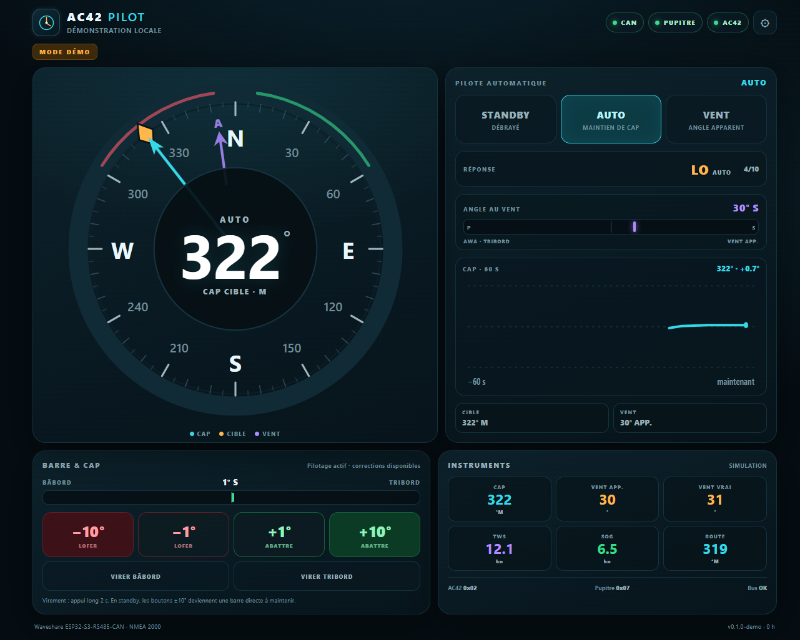
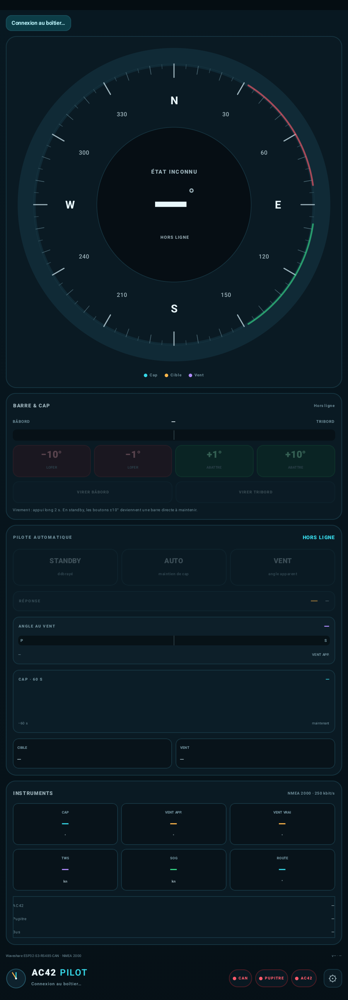

# AC42 Pilot — web interface for the Simrad AC42 autopilot

**English** · [Français](README.fr.md) · [Español](README.es.md)

Firmware for the
[**Waveshare ESP32-S3-RS485-CAN**](https://www.waveshare.com/product/esp32-related/boards-kits/esp32-s3/esp32-s3-rs485-can.htm)
module that exposes a mobile web interface to control a **Simrad AC42**
autopilot on a **NMEA 2000** bus.

The project is inspired by the Signal K plugin
[`signalk-ac42-autopilot`](https://github.com/CaptnOliv/signalk-ac42-autopilot)
for both the interface and the Simnet protocol, but it runs standalone: no
Signal K, no server, no onboard computer. The board connects directly to the
NMEA 2000 bus and starts a Wi-Fi access point. A local network (STA) can be
configured from the settings page; if that network becomes unreachable, the
fallback AP is re-enabled automatically.



Desktop web interface (1280 px). Mobile interface (390 px):
[docs/screenshot-mobile.png](docs/screenshot-mobile.png).

Network settings page: [docs/screenshot-settings.png](docs/screenshot-settings.png).

> The detailed protocol, wiring and API documents are currently in French.

## Inspiration

The firmware, web interface and Android app are **inspired by the SignalK
plugin [`signalk-ac42-autopilot`](https://github.com/CaptnOliv/signalk-ac42-autopilot)**,
which controls an AC42 from Signal K. This project reuses:

- the layout and ergonomics of the web interface (compass, modes, course
  changes, long-press tack, direct NFU rudder control, settings);
- the Simnet PGN 130850 and 130845 frames, command events and directions
  validated on a real AC42;
- active B&G controller detection and command transmission using its NMEA 2000
  source address.

The main difference is the architecture: here everything runs on the ESP32-S3
board, without Signal K, without `canboat` and without an onboard computer. The
`signalk-ac42-autopilot` plugin remains the protocol reference and the
inspiration for this project. This project is neither affiliated with nor
endorsed by Signal K or by the plugin author.

## Built with vibe coding

This project was built through **“vibe coding”**: the ESP32 firmware, embedded
web interface, Android app, documentation and tests were written in dialogue
with an AI, starting from human goals and feedback.

- **Tool**: [OpenCode](https://opencode.ai), a command-line development agent.
- **Model**: **DeepSeek** (DeepSeek V4.1 Flash).

The AC42/Simnet protocol was not invented: it comes from the
`signalk-ac42-autopilot` plugin and from tests on real hardware. Vibe coding
sped up writing the code; it did not replace verification — commissioning must
still be done at the dock, with the precautions below.

## Safety warning

**This project sends real commands to an autopilot.** It is neither certified
nor approved by Simrad/Navico. A wiring, protocol or usage mistake can cause
unexpected rudder movement.

- Test **at the dock first**, with the rudder clear and someone ready to switch
  to standby.
- Always keep a human watch and a way to stop the autopilot.
- Never rely on this interface for vessel safety.
- Check that frame injection on your NMEA 2000 bus is allowed and suitable for
  your installation.

The AC42 only accepts PGN 130850 commands if they carry **the source address of
an active B&G/Simrad controller** (control head, MFD, Triton…) that transmits
its PGN 65305 heartbeat. The firmware detects that controller and sends
commands with its source address, exactly like the Signal K plugin. Without an
active controller on the bus, the AC42 rejects the commands.

## Project status

- Firmware built with PlatformIO 8.0.0 / Arduino ESP32 3.3.12.
- NMEA 2000 frame tests: 60 checks, all passing.
- Web interface tested on desktop and mobile (390 px) with the demo server.
- Android app built (debug APK) and JSON parsing tests: 3/3.
- **Not yet validated on a real AC42 with this board**: the protocol comes from
  the `signalk-ac42-autopilot` plugin, which was validated on an AC42, but
  commissioning must be done at the dock.

## Features

- Embedded responsive web interface, in French, with no external dependency.
- **Standby**, **Auto** (heading hold) and **Wind** (apparent angle) modes.
- Heading changes of **±1°** and **±10°**, with the direction adapted to the
  mode.
- Port/starboard **tack** via a 2-second long press.
- **Direct NFU rudder control** in standby: held press, 300 ms keepalive,
  automatic stop through a watchdog (configurable delay, 8 s maximum).
- Rudder response profile **LO / HI / AUTO** and response level 1–10 read from
  PGN 130845.
- Automatic detection of the B&G controller and AC42 addresses; addresses can
  be forced from the interface.
- Compass, target, apparent/true wind, SOG, COG, rudder and depth depending on
  the PGNs available on the bus.
- Diagnostics: CAN state, N2K addresses, counters, log, warnings.
- **AP by default**, STA network configurable from the settings page,
  **automatic fallback AP**, mDNS `ac42-pilot.local`, settings persisted in
  NVS.
- PC demo server to work on the interface without hardware.
- NMEA 2000 frame tests runnable on a PC.

## Hardware

The project uses the
[**Waveshare ESP32-S3-RS485-CAN**](https://www.waveshare.com/product/esp32-related/boards-kits/esp32-s3/esp32-s3-rs485-can.htm)
module (SKU 32154, or 34781 for the external-antenna version). This is the
module targeted by `platformio.ini` and by the pinout below.

- 7–36 V power on the terminal block, or 5 V USB-C for development.
- CAN H / CAN L connection to the NMEA 2000 backbone.
- 120 Ω termination at both ends of the backbone. The board's 120 Ω jumper must
  only be closed when the board is at the end of the bus.
- An active B&G or Simrad controller/control head on the same bus.

Pinout used:

| Signal | GPIO |
|---|---|
| CAN TX | 15 |
| CAN RX | 16 |
| RS485 TX (not used) | 17 |
| RS485 RX (not used) | 18 |
| RS485 DIR (not used) | 21 |
| RTC SDA/SCL (not used) | 39 / 38 |

See [docs/WIRING.md](docs/WIRING.md) (in French) for wiring and precautions.

## Build and flash

Prerequisites: [PlatformIO](https://platformio.org/) (VS Code or CLI).

```bash
pio run
pio run -t upload
pio device monitor
```

The project uses:

- PlatformIO `espressif32@8.0.0`;
- Arduino ESP32 3.x framework;
- ArduinoJson 7;
- target board `esp32-s3-devkitc-1`, 16 MB flash, 3 MB application partition;
- USB CDC enabled at boot (`ARDUINO_USB_CDC_ON_BOOT=1`) for the serial monitor
  on the USB-C port.

If the board is not detected, hold **BOOT**, press **RESET**, release **BOOT**,
then start the upload again. The serial port runs at 115200 baud. If uploading
at 921600 baud fails, lower `upload_speed` to `460800` in `platformio.ini`.

After building, memory usage is about **1.06 MB of flash** and **58 KB of RAM**
(excluding Wi-Fi stacks), leaving headroom in the 3 MB partition.

## Wi-Fi

**No local network is configured at the factory.** At boot:

- if a STA SSID has been saved and is reachable, the board connects to it;
- if the STA SSID is empty, the AP starts immediately;
- if a STA SSID is configured but unreachable, the fallback AP starts after
  about **15 seconds**;
- if the board was connected and then loses the network, the fallback AP starts
  after about 10 seconds;
- once the AP is active, it remains available even if the STA reconnects
  (AP+STA mode) until the next reboot.

AP defaults:

| Parameter | Value |
|---|---|
| SSID | **`AC42-Pilot-XXXX`** (MAC suffix) |
| Password | **`ac42pilot`** |
| Address | **192.168.4.1** |

The ESP32-S3 is **2.4 GHz only**. A local network configured on 5 GHz only
cannot be joined and will trigger the fallback AP.

> Change the default AP password on the settings page.

> **Upgrading from the previous version**: any previously stored STA network is
> erased. The AP starts, then the network can be configured again on the
> settings page.

## First start

1. Power the board.
2. Connect to the **`AC42-Pilot-XXXX`** Wi-Fi network with the
   **`ac42pilot`** password.
3. Open **http://192.168.4.1/**.
4. Go to **Réglages** (Settings) to configure a local network (STA), the AP
   password, the hostname or the N2K addresses.
5. Click **Enregistrer** (Save). If the interface says a reboot is required,
   click **Redémarrer** (Reboot).
6. After the reboot:
   - if the STA network is reachable, the board connects to it and its IP
     appears in the serial monitor;
   - otherwise, the fallback AP starts again after about 15 seconds.
7. To return to AP-only mode, clear the STA SSID in the settings.

Changing the SSID, password or hostname saves the settings and then requires an
explicit reboot: the interface shows the save result and does not drop the
connection by itself.

### Settings page

- **Enregistrer** (Save) shows the result on the page (success or the exact
  error).
- A network change (SSID, password, hostname) is saved and then applied after
  clicking **Redémarrer** (Reboot).
- A validation or NVS write error is shown on the page; the detail is also
  written to the log (`/api/log`) and to the serial monitor. Firmware log
  messages are in French:
  ```text
  Réglages: POST reçu (… octets, type 'application/json')
  Réglages enregistrés
  ```
  or
  ```text
  Réglages refusés: <motif>
  ```

## IP address in the serial monitor

The board's IP address is printed at boot and repeated about every 60 seconds:

```text
Wi-Fi AP: IP 192.168.4.1 - http://192.168.4.1/
Wi-Fi STA: IP 192.168.1.42 - http://192.168.1.42/ (RSSI -52 dBm)
```

Command:

```bash
pio device monitor
```

If both AP and STA are active, both addresses are printed.

## Usage

- **STANDBY / AUTO / VENT** (Wind): sends the mode change to the AC42.
- **−1° / +1° / −10° / +10°**: heading change in Auto, wind-angle change in
  Wind. Commands are ignored/inhibited in standby.
- **Tack**: hold the button for 2 seconds; the progress bar prevents accidental
  triggers.
- **Direct rudder**: in standby, the ±10° buttons become `BARRE BÂBORD` (port
  rudder) and `BARRE TRIBORD` (starboard rudder). Holding your finger moves the
  rudder; releasing sends `stop`. The firmware also stops the rudder if the
  keepalive disappears or after 8 seconds.
- **Response**: tap the tile to cycle AUTO → LO → HI → AUTO.
- **Réglages** (Settings): Wi-Fi, N2K addresses, rudder safety timeout,
  diagnostics and log.

Buttons are disabled until a controller heartbeat is detected, because the AC42
would reject commands. The AC42 address is detected automatically; if not
found, target 0x02 is used and flagged.

## Architecture

```text
src/
  main.cpp                 initialization and main loop
  protocol/
    n2k_codec.c/.h         29-bit identifiers, fast-packet
    ac42_protocol.c/.h     PGN decoding, frame building, state
  n2k_bus.cpp/.h           TWAI driver 250 kbit/s, reception, bus-off
  ac42_controller.cpp/.h   addresses, commands, NFU safety, levels
  wifi_manager.cpp/.h      AP+STA, mDNS
  web_server.cpp/.h        REST, settings, log, embedded UI
  app_config.cpp/.h        NVS
  app_log.cpp/.h           circular log
  web/index.html           web interface (single file)
tests/test_protocol.c      host-side protocol tests
tools/mock_server.py       UI demo server
android/                   native Android app (Kotlin/Compose)
docs/                      protocol, wiring, API
```

The protocol core is **pure C**, with no Arduino/ESP32 dependency. It can
therefore be tested on a PC.

## Protocol tests

On Linux, macOS or WSL:

```bash
cd tests
./run_tests.sh
```

Or manually:

```bash
gcc -std=c11 -Wall -Wextra -O2 -Iinclude \
  tests/test_protocol.c src/protocol/n2k_codec.c src/protocol/ac42_protocol.c \
  -lm -o tests/test_protocol
./tests/test_protocol
```

The tests check, among other things, PGN 130850 frames byte by byte (modes,
course changes, tack, rudder, response), the PGN 130845 request, fast-packet
reassembly and decoding of PGNs 65305/65340/65341/127237/127250/130306/129026/
127245.

## Demo server

To modify the interface without a board:

```bash
python tools/mock_server.py --port 8090
```

Then open http://127.0.0.1:8090/. The server simulates modes, instruments,
course changes, tacks and direct rudder control. It is marked **MODE DÉMO** in
the interface and sends no real frames.

## Android app

A native Android sub-project lives in [`android/`](android/README.md)
(documentation in French). It reproduces the web page's interface and commands,
with a compass, Auto/Wind/Standby modes, course changes, long-press tack,
direct NFU rudder control, settings and diagnostics.



Android app v0.2.0 on a phone, offline without a connected board: compass,
rudder & course, autopilot and instruments, with the status bar at the bottom.

- Language: Kotlin + Jetpack Compose.
- Connection: board REST API over local HTTP.
- Default address: `http://192.168.4.1`, editable in the app.
- Android build validated and JSON parsing tests: 3/3.

### Download the APK

[**⬇ Download the Android APK v0.2.0 (debug)**](https://github.com/Soleiado/ac42-pilot-esp32/releases/latest/download/ac42-pilot-0.2.0-debug.apk)

- APK signed with the Android debug key, to install manually (allow unknown
  sources), not through the Play Store.
- `minSdk 26`, `targetSdk 34`, about 9.6 MB.
- SHA-256: `BC210637C479DD39B6D413FCF36A8A8674C77A1DB08CA3052D89FF9D00D0F563`
- All versions: [Releases page](https://github.com/Soleiado/ac42-pilot-esp32/releases).

A local build is still possible:

```powershell
cd android
$env:JAVA_HOME = 'C:\Program Files\Eclipse Adoptium\jdk-21.0.13.9-hotspot'
.\gradlew.bat :app:assembleDebug
```

## REST API

The endpoints are documented in [docs/API.md](docs/API.md) (in French).
Examples:

```bash
curl http://192.168.4.1/api/status
curl -X POST http://192.168.4.1/api/mode \
  -H 'Content-Type: application/json' -d '{"mode":"auto"}'
curl -X POST http://192.168.4.1/api/course \
  -H 'Content-Type: application/json' -d '{"side":"stbd","deg":1}'
```

## Protocol

Details on the PGNs, command bytes, bitfield mode and the need to use the
controller source address are in [docs/PROTOCOL.md](docs/PROTOCOL.md)
(in French).

## Known limitations

- **Nav** is not implemented: the mode is displayed, but course changes and
  tacks are disabled.
- Confirmed on AC42. NAC-2/NAC-3/AC12 are probably compatible but have not been
  tested here.
- True wind (TWA/TWS) is only displayed if the bus provides a
  true/water-referenced PGN 130306 or a usable true wind direction; with an
  apparent-only sensor, only AWA/AWS are available.
- The firmware does not send an NMEA 2000 Address Claim: it injects command
  frames with the active controller's address, like the original plugin.
- No HTTP authentication: protect the Wi-Fi and do not expose the board on an
  untrusted network.
- The board's RS485 and RTC are not used in this version.
- No OTA and no log/history persistence.
- The interface's heading history is kept in the browser (60 s).

## Credits and license

- AC42/Simnet protocol: reverse engineering of the
  [`signalk-ac42-autopilot`](https://github.com/CaptnOliv/signalk-ac42-autopilot)
  plugin (Apache-2.0).
- PGN definitions: [canboat](https://github.com/canboat/canboat) (Apache-2.0).
- Board and pinout: Waveshare ESP32-S3-RS485-CAN documentation.
- Built with **vibe coding** using **OpenCode** and **DeepSeek**.

The code in this repository is released under the MIT license — see
[LICENSE](LICENSE). Protocol information from third-party projects remains
subject to their respective licenses.
