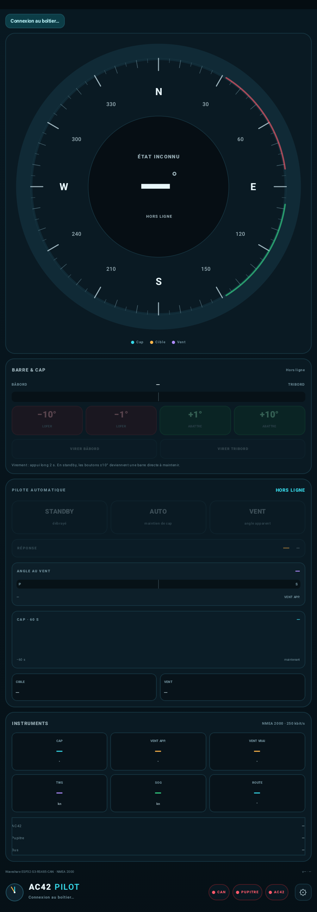

# AC42 Pilot — application Android

Application native Android qui reprend les fonctions et la présentation de
l’interface web embarquée du boîtier **Waveshare ESP32-S3-RS485-CAN**.

## Aperçu



Capture réelle sur téléphone, hors ligne sans boîtier connecté : compas,
barre & cap, pilote automatique et instruments, barre d’état en bas.

## Télécharger l’APK

[**⬇ Télécharger l’APK Android v0.2.0 (debug)**](https://github.com/Soleiado/ac42-pilot-esp32/releases/latest/download/ac42-pilot-0.2.0-debug.apk)

- APK signé en debug, à installer manuellement (sources inconnues autorisées).
- `minSdk 26`, `targetSdk 34`, environ 9,6 Mo.
- SHA-256 : `BC210637C479DD39B6D413FCF36A8A8674C77A1DB08CA3052D89FF9D00D0F563`
- Toutes les versions : [Releases](https://github.com/Soleiado/ac42-pilot-esp32/releases).

Elle dialogue avec le firmware via la même API REST, sur le réseau local :

- `http://192.168.4.1` par défaut (AP du boîtier) ;
- ou l’adresse IP STA du boîtier, configurable dans l’application.

## Fonctionnalités

- Écran unique avec compas, cible, vent, barre et instruments.
- Ordre des tuiles : **compas**, **barre & cap**, **pilote automatique**, puis
  **instruments** ; la barre d’état et le bouton Réglages sont en bas.
- Icône de l’application : barre à roue.
- Modes **Standby**, **Auto**, **Vent**.
- Corrections **±1° / ±10°**.
- **Virement** par appui long de 2 s.
- **Barre directe NFU** en standby : appui maintenu, keepalive 300 ms, arrêt
  de sécurité après 8 s.
- Réglage de réponse **LO / HI / AUTO** et niveau 1–10.
- Historique de cap 60 s côté application.
- Écran de réglages : adresse du boîtier, Wi-Fi AP/STA, nom d’hôte mDNS,
  adresses N2K, délai de sécurité barre, diagnostic et journal.
- Même charte graphique sombre que la page web.
- HTTP local en clair autorisé (`usesCleartextTraffic`), car le boîtier est sur
  un réseau local sans TLS.

## Prérequis

- Android Studio récent ou JDK 21 + Android SDK 34.
- `compileSdk 34`, `minSdk 26`, `targetSdk 34`.
- Gradle est fourni par le wrapper.

## Compilation

```powershell
cd D:\pascal\project\ac42-pilot-esp32\android
$env:JAVA_HOME = 'C:\Program Files\Eclipse Adoptium\jdk-21.0.13.9-hotspot'
.\gradlew.bat :app:assembleDebug
```

APK :

```text
app\build\outputs\apk\debug\app-debug.apk
```

Installation sur un appareil connecté :

```powershell
adb install -r app\build\outputs\apk\debug\app-debug.apk
```

Tests unitaires (parsing JSON) :

```powershell
.\gradlew.bat :app:testDebugUnitTest
```

En cas de build avec un autre JDK, configurer `org.gradle.java.home` ou lancer
Gradle avec `JAVA_HOME` pointant vers un JDK 17/21.

Le fichier `local.properties` (non versionné) doit pointer vers votre SDK
Android, par exemple :

```properties
sdk.dir=D\:\\Android\\SDK
```

Sinon, définir `ANDROID_HOME` ou ouvrir le projet dans Android Studio.

## Utilisation

1. Connecter le téléphone au Wi-Fi du boîtier (`AC42-Pilot-XXXX`) ou au même
   réseau STA que lui.
2. Lancer l’application.
3. Si nécessaire, ouvrir **Réglages**, saisir l’adresse du boîtier, puis
   **Tester / charger**.
4. Vérifier les chips `CAN`, `PUPITRE` et `AC42` avant d’envoyer une commande.

L’application ne fait pas de découverte mDNS automatique : utiliser l’IP
affichée dans le moniteur série du firmware. Elle est rappelée toutes les
60 secondes.

Pour tester l’interface avec l’émulateur Android et le serveur de
démonstration, utiliser l’adresse `http://10.0.2.2:8090` (l’hôte vu depuis
l’émulateur), après avoir lancé `python tools/mock_server.py --port 8090` à la
racine du projet.

## Architecture

```text
app/src/main/java/com/ac42pilot/app/
  MainActivity.kt          activité Compose
  data/
    Models.kt              modèles et parsing JSON
    Ac42Api.kt             client OkHttp de l’API REST
    SettingsStore.kt       adresse du boîtier persistée
  ui/
    Ac42ViewModel.kt       polling, commandes, NFU, réglages
    PilotScreen.kt         écran principal
    Components.kt          compas, cartes, boutons, instruments
    SettingsDialog.kt      page de réglages
    Theme.kt               couleurs et typographie
```

Le ViewModel interroge `/api/status` toutes les 900 ms et s’arrête lorsque
l’application passe en arrière-plan. La barre directe est arrêtée dès que
l’application est mise en pause.

## Sécurité

- L’API du boîtier n’a pas d’authentification HTTP ; l’application est prévue
  pour un réseau local de bord.
- Ne pas exposer le boîtier ou le téléphone sur Internet.
- Tester les commandes à quai, barre dégagée.
- L’application n’est pas un organe de sécurité certifié.
